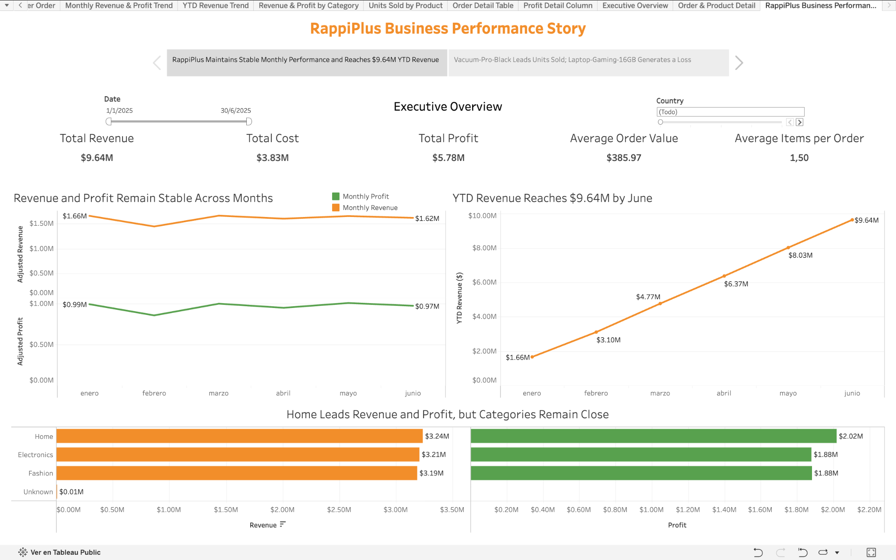
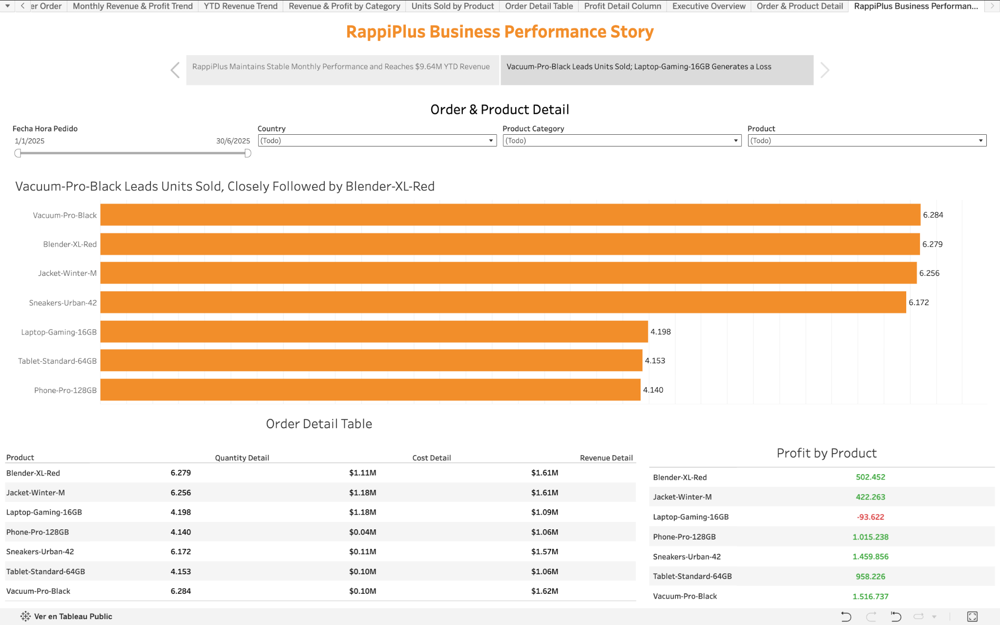

# RappiPlus Business Performance Analysis

**Author:** Rodrigo Garza García  
**Role:** Public & International Affairs | Business Analysis & Data Analytics  
**Study period:** January 1 – June 30, 2025  
**Portfolio:** [GitHub Profile](https://github.com/rogarzag)

End-to-end business performance analysis for **RappiPlus**, covering data quality, revenue, costs, profitability, marketing, conversion, retention, product performance, and an A/B test. The project combines **Python, SQL, statistical testing, and Tableau** to turn multiple data sources into business insights and interactive dashboards.

## 📊 Interactive Dashboard

Explore the full interactive story on Tableau Public:

[View Dashboard on Tableau Public](https://public.tableau.com/views/RappiPlusBusinessPerformanceDashboard/RappiPlusBusinessPerformanceStory?:language=es-ES&:sid=&:redirect=auth&:display_count=n&:origin=viz_share_link)

## 🎯 Business Objective

The project evaluates RappiPlus from several business perspectives:

- Can the available data be trusted?
- What do revenue and available product costs show about product profit?
- Which products and categories drive performance?
- Where do users drop off in the conversion funnel?
- Do users return after registration?
- Did the checkout UI experiment improve conversion?
- How can the results be communicated clearly through an executive dashboard?

## 📌 Executive Summary

The raw dataset reports **$51.99M in revenue**, but a small number of extreme-quantity records have a disproportionate impact on the results. These observations account for **81.45% of reported revenue** and **91.12% of known product cost**.

To better represent typical operating performance, the Tableau dashboards use an adjusted view that excludes extreme and invalid quantities.

### Adjusted business performance

- **Revenue:** $9.64M
- **Known Product Cost:** $3.83M
- **Product-Level Profit Before Marketing:** $5.78M
- **Average Order Value:** $385.97
- **Average Items per Order:** 1.50
- **Top-Selling Product:** Vacuum-Pro-Black — 6,284 units

### Customer behavior

- **Purchase / first-visit user ratio:** 80.04%
- Largest relative funnel drop: `begin_checkout → add_payment_info`
- **Week-3 retention:** approximately 40%–44% across cohorts
- Best week-3 cohort: **February — 43.98%**

### A/B test

- Control conversion: **15.69%**
- Treatment conversion: **16.29%**
- **p-value: 0.4161**
- Result: no statistically significant evidence that the checkout UI change improved conversion.

## What the Results Mean for the Business

| Finding | Business meaning | Recommendation |
|---|---|---|
| Unusually large quantities account for 81.45% of the original revenue. | A few records have a major effect on the overall picture. | Keep the original and adjusted views separate and review the unusual orders before using them for planning. |
| The largest relative funnel drop occurs between checkout and payment information. | This is the clearest point in the reported journey to investigate for lost purchases. | Review this step first when exploring checkout improvements, after checking the event records. |
| The checkout redesign did not show a statistically significant conversion improvement. | The experiment does not provide enough evidence to recommend the redesign as a way to increase conversion. | Keep the existing version as the reference and gather more evidence before recommending a change on conversion grounds. |
| Vacuum-Pro-Black leads unit sales, while the dashboard also shows profit by product. | The most popular product is not necessarily the most profitable. | Review sales and product profit together when choosing which products to prioritize. |
| February has the strongest week-3 retention, at 43.98%. | It provides a useful comparison with the other cohorts in this analysis. | Use February as a reference when reviewing return activity, without assuming why its result was higher. |

**Main takeaway:** prioritize the checkout-to-payment step for further review, assess products using both sales and profit, and avoid presenting the tested redesign as a proven improvement.

## 🗂️ Data Sources

The project uses multiple datasets covering different areas of the business:

- **Orders:** order-level sales, quantities, prices, discounts, products, countries, and devices
- **Product Catalog:** product categories, suppliers, and unit costs
- **Marketing:** marketing spend by date, country, campaign, and channel
- **Events (SQL):** user activity across the conversion funnel
- **Users & User Activity (SQL):** registration and retention behavior
- **Checkout Experiment:** control and treatment results for an A/B test

## 🧹 Data Quality & Preparation

The public Python notebook loads the data, converts date fields, checks missing values and duplicates, flags invalid and unusually large quantities, joins product costs, and calculates original and adjusted sales results.

The documented preparation decisions also retain orders with unknown countries instead of assigning an unsupported location.

A total of **300 orders (1.20%)** had an unknown country. These records were retained because they contained valid sales information and there was not enough evidence to assign them reliably to another country.

## 💰 Profitability & Sales Analysis

The notebook keeps both the raw and adjusted views.

### Raw profitability view

- Reported Revenue: **$51.99M**
- Known Product Cost: **$43.12M**
- Marketing Spend: **$2.87M**
- Estimated Profit After Product Cost and Marketing: **$5.99M**

### Adjusted operating view

The adjusted view excludes extreme and invalid quantities to avoid allowing a small number of unusually large records to dominate the analysis.

- Adjusted Revenue: **$9.64M**
- Adjusted Product Cost: **$3.83M**
- Adjusted Product-Level Profit: **$5.78M**

Marketing is analyzed separately in the notebook. It is not directly allocated to individual products or orders in Tableau because the marketing dataset is stored at a different level of granularity.

## 🛒 Conversion Funnel

SQL was used to measure unique users across the expected customer journey:

`first_visit → select_item → add_to_cart → begin_checkout → add_payment_info → purchase`

Key results:

- `first_visit`: 7,796 users
- `purchase`: 6,240 users
- Purchase / first-visit user ratio: **80.04%**
- Largest relative decline: `begin_checkout → add_payment_info` with **86.71%** stage conversion

The `select_item → add_to_cart` ratio is slightly above 100%, indicating that the event tracking is not strictly sequential for every user.

## 🔁 Cohort Retention

Monthly cohorts were created using registration month and user activity at:

- Day 7
- Day 14
- Day 21

Week-3 retention was approximately **40%–44%** across the cohorts analyzed.

The **February cohort** achieved the strongest week-3 retention at **43.98%**.

## 🧪 A/B Test — Checkout UI

A two-proportion z-test was used to compare checkout conversion between the control and treatment groups.

- Control: **15.69%**
- Treatment: **16.29%**
- Z-statistic: **-0.8133**
- p-value: **0.4161**
- Significance level: **0.05**

Because the p-value is greater than 0.05, the null hypothesis is not rejected. The observed difference is not statistically significant.

## 📈 Tableau Dashboards

### Executive Overview



### Order & Product Detail




### 1. RappiPlus Executive Overview

Includes:

- Adjusted Revenue
- Adjusted Cost
- Adjusted Profit
- Average Order Value
- Average Items per Order
- Monthly Revenue & Profit
- YTD Revenue
- Revenue & Profit by Category
- Date and Country filters

### 2. RappiPlus Order & Product Detail

Includes:

- Units Sold by Product
- Product-level Quantity, Cost, Revenue, and Profit
- Conditional profit formatting
- Date, Country, Product Category, and Product filters

Both dashboards are combined in the **RappiPlus Business Performance Story**.

## Scope of the Results

- These recommendations come from a training project; their business impact was not measured.
- Product profit is before marketing and other operating expenses and only includes orders with known product costs. Revenue includes a broader set of orders, so the displayed revenue and cost totals do not directly reconcile to product profit.
- Unusual quantities are flagged for review, not automatically proven errors. Funnel counts summarize users at each event rather than confirming that every user followed the full sequence; one intermediate ratio exceeds 100%.

## 🛠️ Tools & Skills

- **Python:** Pandas, data cleaning, validation, exploratory analysis
- **SQL:** funnel analysis, cohort retention, conditional aggregation
- **Statistics:** two-proportion z-test, hypothesis testing
- **Tableau:** KPI dashboards, filters, interactive views, business storytelling
- **Business Analysis:** KPI definition, data interpretation, profitability analysis, decision-oriented recommendations

## 📂 Repository Structure

```text
rappiplus-business-performance-analysis/
│
├── README.md
├── RappiPlus_Business_Performance_Portfolio.ipynb
├── requirements.txt
│
└── images/
    ├── executive_overview.png
    └── order_product_detail.png
```

## 🔐 Reproducibility Note

The SQL portion was originally executed using a TripleTen training database. Database credentials are intentionally excluded from this public repository.

The public notebook includes the SQL queries for review. Running them requires access to the original training tables and a PostgreSQL connection; connection and query-execution code are not included.

## 📎 Project Context

This was developed as the final project of the **TripleTen Data Analyst Bootcamp**, integrating the main tools and analytical techniques used throughout the program into a single business case.
